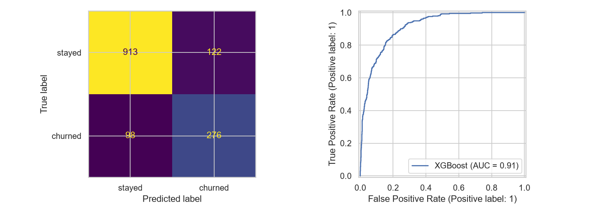
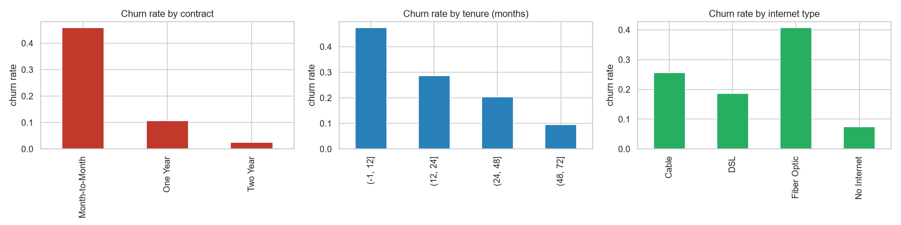
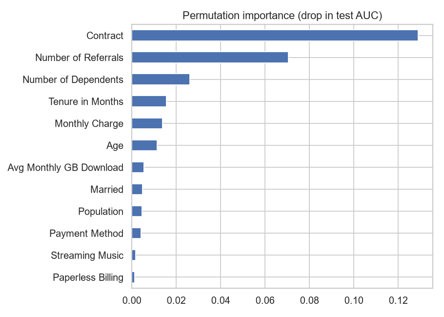

# Telecom Customer Churn Prediction

Machine learning project: predict telecom customer churn, find what drives it, and package the model as a reusable scikit-learn pipeline.

**Portfolio project** | Codecademy Machine Learning Career Path

---

## Project Scope

### Goals

1. Predict whether a customer will churn (leave the service) in the next quarter.
2. Find what drives churn so the business can prioritize retention efforts.
3. Package the model as a scikit-learn pipeline that can score new customers.

### Data

**Source:** IBM Telco Customer Churn dataset (via [Hugging Face mirror](https://huggingface.co/datasets/jason1966/aadityabansalcodes_telecommunications-industry-customer-churn-dataset))

- **7,043 customers** from Q3 in California
- **Five tables** merged on Customer ID: demographics, location, population, services, status
- **Target:** `Churn` (1 = churned, 0 = stayed), **26.5% churn rate**
- **35 features** used by the model: demographics (age, gender, dependents), services (phone, internet, streaming), contract terms, billing, tenure, zip-level population. Customer ID, city, zip code and coordinates are excluded.

**Known limitations:**
- Single quarter snapshot (no temporal trends)
- Fictional data (IBM sample)
- California only (geographic bias)

### Analysis

1. **ETL:** Extract five CSV tables, merge on Customer ID, drop target-leaking columns (Churn Score, Satisfaction Score, Customer Status, Churn Reason), load cleaned data.
2. **EDA:** Churn rate by contract type, tenure, services; correlation analysis; class imbalance check.
3. **Feature engineering:** Train/test/validation split (60/20/20) before any transformation to prevent leakage.
4. **Modeling:** Baseline (logistic regression), tree-based models (Random Forest, XGBoost, LightGBM), cross-validation, hyperparameter tuning with RandomizedSearchCV.
5. **Evaluation:** ROC-AUC, precision-recall, confusion matrix, feature importance.
6. **Pipeline:** scikit-learn `Pipeline` with `ColumnTransformer` for numerical (impute + scale) and categorical (impute + one-hot) features, serialized with joblib.

---

## Repository Structure

```
.
├── data/
│   ├── sample_customers.csv  # 20 held-out rows for trying the CLI
│   ├── raw/                # Original five IBM tables
│   └── processed/          # churn.csv after ETL
├── notebooks/
│   └── churn_analysis.ipynb  # End-to-end workflow
├── src/
│   ├── etl.py              # Extract-Transform-Load
│   ├── pipeline.py         # Feature preprocessing and Pipeline factory
│   └── predict.py          # CLI for scoring new data
├── tests/
│   └── test_pipeline.py    # Pipeline smoke tests
├── models/
│   └── best_model.pkl      # Trained pipeline (joblib)
└── README.md
```

---

## Quick Start

```bash
# Clone and install
git clone https://github.com/MrPetete/ml-pipeline-portfolio.git
cd ml-pipeline-portfolio
python -m venv .venv
source .venv/bin/activate  # Windows: .venv\Scripts\activate
pip install -r requirements.txt

# Run ETL
python -m src.etl

# Re-run the full workflow (also rebuilds models/best_model.pkl)
jupyter notebook notebooks/churn_analysis.ipynb

# Predict
python -m src.predict data/sample_customers.csv
```

---

## Results

Stratified 60/20/20 train/validation/test split. Model selection on 5-fold CV and the validation set; the test set was scored once.

| Model | CV ROC-AUC | Validation ROC-AUC |
|---|---|---|
| **XGBoost** | 0.908 | 0.909 |
| LightGBM | 0.899 | 0.901 |
| Logistic Regression | 0.900 | 0.896 |
| Random Forest | 0.891 | 0.889 |

**Final model: tuned XGBoost** (RandomizedSearchCV, 15 candidates), refit on train+validation.

| Test metric | Value |
|---|---|
| ROC-AUC | 0.913 |
| PR-AUC | 0.786 |
| Accuracy | 0.84 |
| Churn precision / recall | 0.69 / 0.74 |

I picked the decision threshold (0.645) on the validation set, not the test set, to avoid overfitting.

**Top drivers** (permutation importance, drop in test AUC): contract type (0.129), number of referrals (0.071), number of dependents (0.026), tenure (0.016), monthly charge (0.014).





---

## Next Steps and Limitations

**Limitations:**
- The data is a fictional IBM sample, so the 0.91 AUC is likely higher than a real telecom would see. Don't compare these numbers to production churn models.
- Single quarter snapshot: no temporal validation, so drift over time is untested.
- Class imbalance (26.5% churn) was handled with class weights and a tuned threshold, not SMOTE or undersampling.
- City, zip code and coordinates were dropped rather than encoded.
- Logistic regression reaches 0.896 validation AUC, so XGBoost adds about 0.013. A simpler model may be the better production choice.

**Future extensions:**
- Time-series split if multi-quarter data becomes available
- Cost-sensitive learning (false negative = lost customer revenue)
- SHAP explanations for interpretability
- Deploy as REST API (FastAPI + Docker)

---

## License

MIT

## Author

[GitHub: MrPetete](https://github.com/MrPetete)
